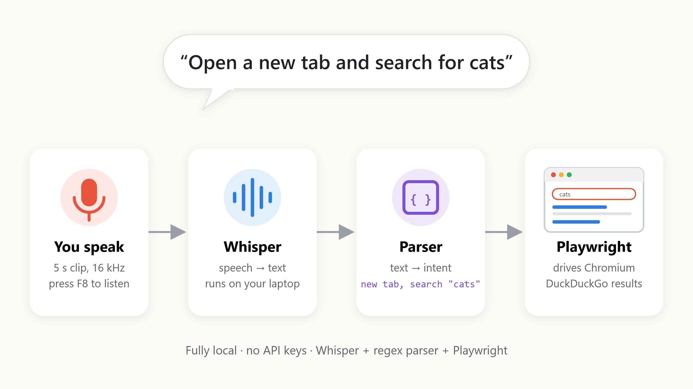

# Voice Browser



A hands-free browser assistant. You speak, Whisper turns your voice into text on your own machine, a small parser works out what you meant, and Playwright does it in Chromium.

Everything runs locally. No API keys, no cloud speech service, no paid tools.

The full write up, covering why fixed audio windows break, the math behind them and how this compares with Thinking Machines Lab's interaction models, is on Medium.

📖 [Hey Browser, Do This.](https://medium.com/@haryakshbhardwaj/is-speech-recognition-still-the-hard-part-of-a-voice-controlled-browser-82067c75daad)

## How it works

```
Your voice
    ↓
Microphone clip (5 seconds, 16 kHz)
    ↓
Whisper (local speech to text, nudged toward command words)
    ↓
Command parser (finds the intent inside a normal sentence)
    ↓
Playwright browser agent
    ↓
Chromium does the action
```

Example

```
"Open new tab and search for white sky"
    ↓ Whisper
"Open new tab and search white sky."
    ↓ Parser
[ new_tab, search "white sky" ]
    ↓ Browser
New tab opens and DuckDuckGo shows the results
```

## Setup

```bash
pip install -r requirements.txt
playwright install chromium
```

## Run

```bash
python assistant.py
```

| Key | Does |
|---|---|
| F8 | Start or stop listening. A beep means it is recording |
| ESC | Quit |

## What you can say

| Say | Does |
|---|---|
| `search for <anything>` | DuckDuckGo search |
| `open <site>` or `go to <site>` | `open youtube` goes to youtube.com and `open google dot co dot in` goes to google.co.in |
| `open first result` or `open result 3` or `open the second webpage` | Opens that search result |
| `click <text>` | Clicks the link or element with that text |
| `scroll down` or `scroll up` | Scrolls the page |
| `go back` or `go forward` or `refresh` | Navigation |
| `new tab` or `close tab` or `close browser` | Tabs and window |
| `open new tab and search <x>` or `open <site> in a new tab` | Does it in a new tab |
| `type <text>` or `press enter` | Keyboard input into the focused field |

Commands work inside normal sentences too, so "can you scroll down a bit" works. If a spoken site does not load, it searches for the words instead.

## Tuning

These constants sit at the top of `assistant.py`.

| Constant | What it changes |
|---|---|
| `WHISPER_MODEL` | `tiny` is fastest, `base` is the default, `small` is more accurate but slower |
| `RECORD_SECONDS` | Length of each listening window |
| `SILENCE_THRESHOLD` | Raise it if background noise triggers commands, lower it if quiet speech is ignored |
| `WHISPER_HINT` | Words Whisper should expect, which cuts down on mishearings |

## Test

```bash
python test_parse.py
```

The parser test includes real sentences from live sessions that used to break, such as "Open browser and search for cats", which once sent the browser to a made-up domain.

## What I learned

Browser automation turned out to be the easy part. Speech interaction was the hard part. The biggest problem was never recognising words. It was knowing when the user had started and finished speaking, and cutting audio into the right pieces. Fixed five second clips cut sentences in half, silent clips made Whisper invent phrases like "Thank you", and a strict parser broke the moment someone spoke naturally.

## Project structure

```
voice-browser/
├── README.md
├── requirements.txt
├── assistant.py        # The app
├── test_parse.py       # Parser test with real spoken sentences
└── prototypes/         # Earlier versions and the first mic, Whisper and browser tests
```

## Next steps

1. Stream audio with overlapping chunks instead of fixed clips
2. Detect end of speech instead of waiting for a timer
3. Replace the rule based parser with an LLM planner for multi step requests like "find the best laptop under 50000 and open the most reviewed one"
